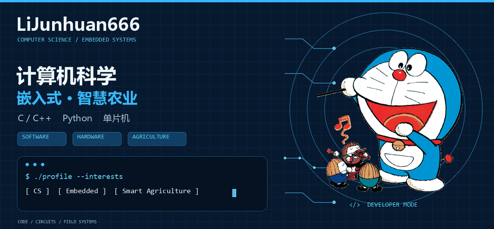
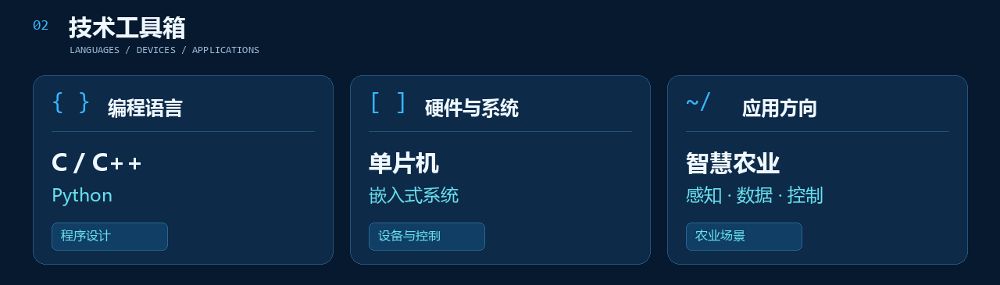
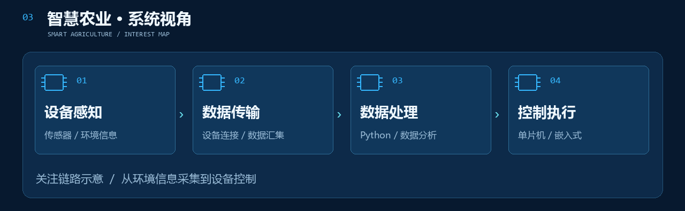
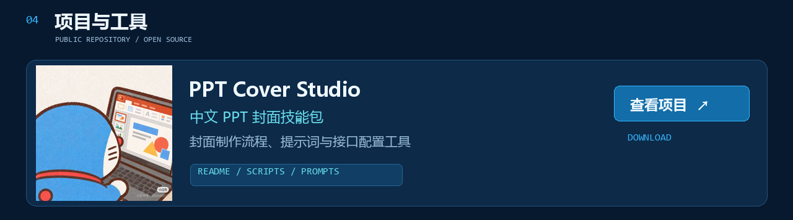

<a href="https://github.com/LiJunhuan666/ppt-cover-studio">项目仓库</a> · <a href="https://github.com/LiJunhuan666/ppt-cover-studio/releases/latest">下载技能包</a>

角色插图来自哆啦A梦官网及主页主人提供的素材，角色及插图版权归原权利人所有；本主页为个人展示，与官方无关联。
